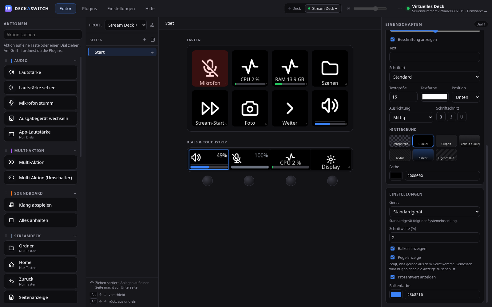
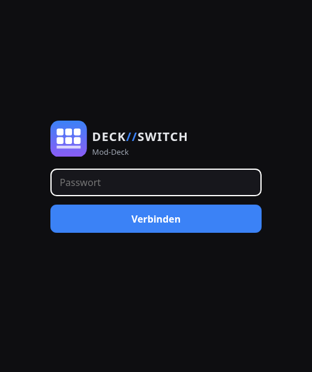
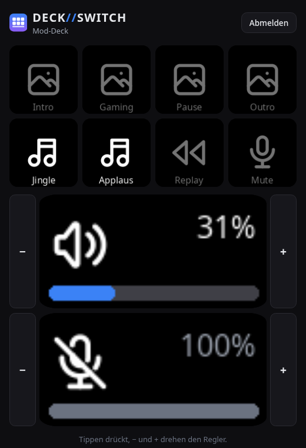
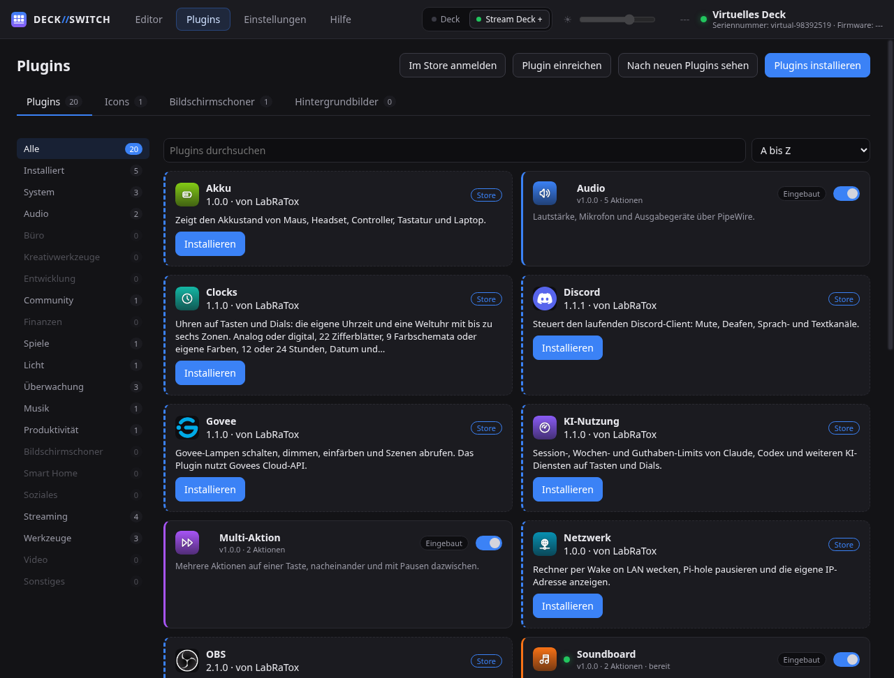
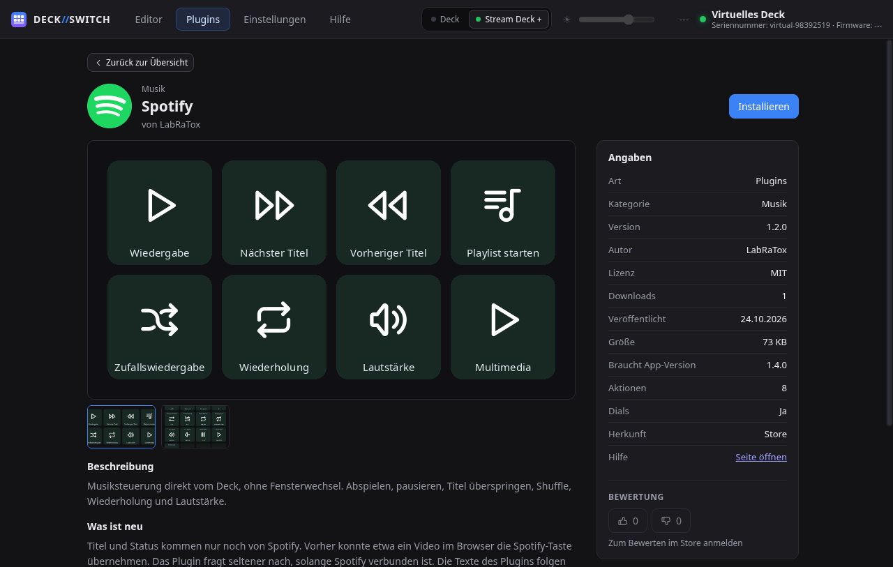
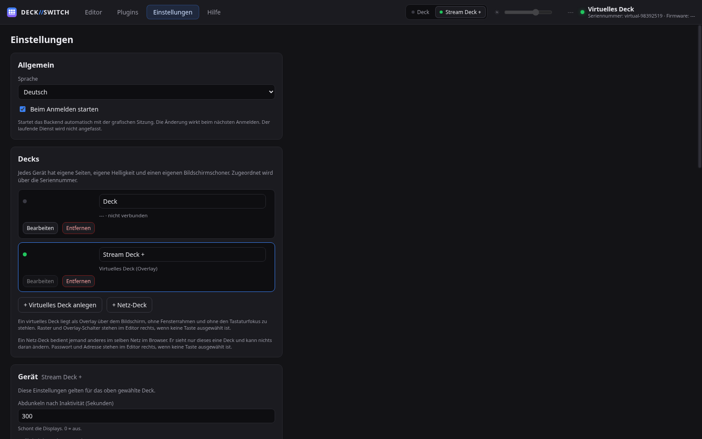

# DECK//SWITCH

**Steuerungssoftware für das Elgato Stream Deck unter Linux.** Ohne Elgatos
offizielle Software, mit eigenem Plugin-System.

*[English version](README.md)*

Entwickelt und am Gerät getestet mit dem **Stream Deck +** auf **CachyOS /
Arch Linux**, KDE Plasma unter Wayland.

Andere Desktops gehen auch. Die App schaut beim Start nach, was die laufende
Sitzung kann, und zeigt nur Aktionen an, die dort auch funktionieren. Was bei
dir fehlt und warum, steht in den Einstellungen.

| | Virtuelles Deck | Fenster steuern |
| --- | --- | --- |
| KDE Plasma (Wayland und X11) | ja | ja |
| Hyprland, Sway | ja | ja |
| XFCE, Cinnamon, MATE, i3 … (X11) | ja | nein |
| GNOME | ja, über XWayland | nein |

Das virtuelle Deck nutzt unter Wayland `zwlr_layer_shell_v1`, unter X11 die
klassischen Fenster-Hinweise. Fehlt die Layer-Shell, etwa unter GNOME oder
Ubuntu, läuft es über XWayland. In jedem Fall nimmt ein Klick den Tastaturfokus
nicht weg. Fenster zu steuern braucht eine Schnittstelle im Compositor: Plasma,
Hyprland und Sway haben eine, GNOME hat keine.

Der Installer läuft auf Arch, Debian, Ubuntu und Fedora. Mit echtem Deck
getestet ist nur CachyOS. Auf den anderen Distributionen ist nur die Installation
selbst geprüft, in frischen Docker-Images.

> Der Name wird **DECK//SWITCH** geschrieben, die Schrägstriche in der
> Akzentfarbe. Technisch heißt alles `deckswitch`: Paket, Dienst,
> Konfigurationsordner.



---

## Was es kann

**Tasten und Dials**
Drei Aktionen pro Taste: Drücken, Doppeldruck, Halten. Dials regeln stufenlos
oder lösen je Drehrichtung eine eigene Aktion aus. Mehrere Belegungen können
sich einen Dial teilen (Dial-Stack). Wischen über den Touchstrip blättert
durch die Seiten.

**Seiten und Ordner**
Beliebig tiefer Seitenbaum, per Drag & Drop sortierbar. Ordner sind einfach
Unterseiten.

**Multi-Aktionen**
Mehrere Schritte nacheinander. Pausen zählen dabei als eigener Schritt, jeder
Schritt lässt sich einzeln abschalten, und das Ganze läuft auf Wunsch in der
Schleife. Dazu gibt es einen Umschalter mit zwei Ketten und eigenem Symbol je
Richtung.

**Aussehen**
Symbol, Beschriftung (Schriftart, Schnitt, Größe, Farbe, Ausrichtung) und
Hintergrund (Farbe, Verlauf, Textur, Bild) für jede Taste. Animierte GIFs
laufen auf der Taste. Für fertige Tastenbilder gibt es eine eingebaute
Werkstatt. Gezeichnet wird immer im Backend, deshalb zeigt die Vorschau genau
das, was auf dem Gerät steht.

**Mehrere Decks**
So viele Geräte gleichzeitig, wie du hast. Jedes bekommt sein eigenes Profil,
seine eigene Helligkeit und eigene Zeiten. Zugeordnet wird über die
Seriennummer.

**Virtuelles Deck**
Ein Deck als Overlay auf dem Bildschirm, mit frei wählbarem Raster. Kein
Fensterrahmen, kein Eintrag in Alt-Tab, und der Tastaturfokus bleibt, wo er
ist. Frei platzierbar, die Stelle merkt sich die App. Mit einem **globalen
Kurzbefehl** holst du es von überall her.

**Netz-Deck**
Ein Deck, das jemand anderes im selben Netz im Browser bedient, zum Beispiel
der Moderator während des Streams. Passwortgeschützt, nichts zu installieren,
und ändern kann der Gast nichts.

<p align="center">
  
  
</p>

**Bildschirmschoner und Hintergrundbilder**
Ein Motiv über alle Tasten und den Touchstrip, animiert oder still. Jede Seite
kann ihr eigenes Hintergrundbild für den Touchstrip haben.

**Plugins**
Sechs Plugins sind eingebaut: Audio, System, Soundboard, Multi-Aktion,
Navigation und der Tabler-Iconset. Im Store gibt es weitere, darunter OBS,
Discord, Spotify, Twitch, YouTube, Steam, Govee, Wetter, eine Akkuanzeige und
einen Uhr-Bildschirmschoner. Für eigene gibt es eine offene API, und ein Plugin
kann die Python- und Systempakete mitbringen, die es braucht. Iconsets sind
ebenfalls Plugins.

Nachinstallieren geht auf vier Wegen: über den **Store** direkt in der App,
aus einer ZIP-Datei, von einer Adresse oder über einen `streamdeck://`-Link
im Browser.

**Integrierter Plugin-Store**
Er zeigt dir alle verfügbaren Plugins, auch die installierten. Noch nicht
installierte erkennst du am gestrichelten Rahmen. Ein Klick auf den Namen
öffnet die Detailseite mit Bildern, Beschreibung, Lizenz, Größe und
Abhängigkeiten. Links filterst du nach Thema, oben nach Art. Dazu kannst du nach
Name, Beschreibung oder Autor suchen und nach Name, neuester Fassung oder
bester Bewertung sortieren.

<p align="center">
  
  
</p>

**Einstellungen**
Sprache, Autostart, Sichern und Wiederherstellen und alles zu den Decks.

<p align="center">
  
</p>

Mehr dazu: [Bedienung](docs/de/operation.md) ·
[Decks](docs/de/decks.md) · [Plugins](docs/de/plugins.md)

---

## Installation

### Mit einem Befehl (alle Distributionen)

```sh
curl -fsSL https://raw.githubusercontent.com/LabRaTox/Deck-Switch/main/scripts/get.sh | bash
```

Das holt `uv`, falls es fehlt, entpackt das neueste Release nach
`~/.local/share/deckswitch/app` und startet den Installer. Node, Rust oder ein
Compiler sind nicht nötig, Fenster und Oberfläche kommen fertig mit dem Release.
Das Passwort wird einmal abgefragt, für alles, was root braucht: fehlende
Systempakete, die udev-Regel und die Gruppe `input`. Danach läuft das Backend,
jetzt und bei jeder Anmeldung, und DECK//SWITCH steht im Anwendungsmenü. Zum
Aktualisieren denselben Befehl noch einmal ausführen, die Einstellungen bleiben.

Das Menü *Hilfe* im Fenster führt zum Repository, zur Discord-Community und zur
Seite *Über* mit der Version.

Zum Entfernen:

```sh
~/.local/share/deckswitch/app/scripts/delete.sh
```

Deine Einstellungen bleiben in `~/.config/deckswitch/`, deine Bilder und Plugins
in `~/.local/share/deckswitch/`. Mit `--all` verschwinden sie auch, nach einer
Rückfrage.

Das läuft durch auf Arch, Debian 13, Ubuntu 22.04 und 24.04 und Fedora 43. Auf
einem Fedora mit Image wie Bazzite nennt der Installer stattdessen den
`rpm-ostree`-Befehl, weil ein Paket dort erst mit dem nächsten Start ankommt.
Ohne `layer-shell`, etwa unter GNOME oder Ubuntu, läuft das virtuelle Deck über
XWayland, ebenfalls ohne Eintrag in der Fensterleiste und ohne den
Tastaturfokus zu nehmen.

Auf Arch und CachyOS ist das Paket weiter unten der bessere Weg, weil pacman es
dann verwaltet.

### Arch und CachyOS

Im AUR steht DECK//SWITCH noch nicht, das Paket liegt am GitHub-Release. Es legt
die udev-Regel und die systemd-Unit gleich dorthin, wo sie hingehören.

Zuerst kommt die Bibliothek für das Deck, denn die gibt es nur im AUR. Mit `paru`
oder `yay` reicht `paru -S python-elgato-streamdeck`, sonst:

```sh
git clone https://aur.archlinux.org/python-elgato-streamdeck.git
cd python-elgato-streamdeck
makepkg -si
cd ..
```

Dann das Paket laden und installieren. Mit der Adresse direkt in `pacman -U`
geht es nicht, pacman sucht dort eine Signatur:

```sh
curl -fLO https://github.com/LabRaTox/Deck-Switch/releases/download/v1.4.1/deckswitch-1.4.1-1-x86_64.pkg.tar.zst
sudo pacman -U ./deckswitch-1.4.1-1-x86_64.pkg.tar.zst
systemctl --user enable --now deckswitch.service
```

Danach einmal in die Gruppe `input` eintragen und neu anmelden. Die brauchst
du für die Aktionen *Tastenkombination* und *Text tippen*:

```sh
sudo usermod -aG input "$USER"
```

Für ein Update lädst du die neue Paketdatei und installierst sie genauso. Selbst
bauen geht auch, die Bibliothek muss dafür ebenfalls schon da sein:

```sh
git clone https://github.com/LabRaTox/Deck-Switch.git
cd Deck-Switch/packaging/aur
makepkg -si
```

### Aus dem Repo

Zum Mitentwickeln:

```sh
git clone https://github.com/LabRaTox/Deck-Switch.git
cd Deck-Switch
./scripts/install.sh
```

`install.sh` macht dasselbe wie der Einzeiler. Im Git-Checkout baut es das
Fenster selbst, wenn `npm` und `cargo` da sind. Mehrfach ausführen ist sicher.

| Option | |
| --- | --- |
| `--no-root` | nichts ändern, was root braucht, stattdessen ausgeben, was bleibt |
| `--no-download` | nichts vom Release nehmen, alles hier bauen |
| `--no-start` | alles installieren, den Dienst aber nicht starten |
| `--no-autostart` | jetzt starten, aber nicht bei der nächsten Anmeldung |

Die Oberfläche läuft dann unter <http://127.0.0.1:8770>, oder als eigenes
Fenster:

```sh
./scripts/start-gui.sh
```

### Gerätezugriff (udev)

Ohne udev-Regel gehört der HID-Knoten root. Das Gerät wäre dann nur als root
ansprechbar. `install.sh` richtet sie ein, von Hand geht es so:

```sh
sudo install -m 644 packaging/70-streamdeck.rules /etc/udev/rules.d/
sudo udevadm control --reload-rules
sudo udevadm trigger --subsystem-match=usb --subsystem-match=hidraw
```

Danach den Stream Deck einmal ab- und wieder anstecken.

Dieselbe Regel richtet auch den Zugriff auf `/dev/uinput` ein. Darüber läuft
die virtuelle Tastatur für **Tastenkombination** und **Text tippen**. Dafür
muss dein Benutzer in der Gruppe `input` sein. `install.sh` trägt dich
ein, von Hand geht es so:

```sh
groups | grep -q input || sudo usermod -aG input "$USER"
```

Die Gruppenmitgliedschaft greift erst nach dem nächsten Anmelden. Ob es
geklappt hat, siehst du in der Oberfläche: In den Einstellungen einer
Hotkey-Aktion steht sonst im Klartext, was fehlt.

### Wenn das Fenster nicht aufgeht

Auf manchen Treibern verträgt sich WebKitGTK nicht mit Wayland, das
Fenster schließt sich nach einer halben Sekunde und im Terminal steht
`Gdk-Message: Error 71 (Protokollfehler) dispatching to Wayland display`.
Mit NVIDIA unter KDE tritt das zuverlässig auf.

Das wird abgefangen: Geht der erste Versuch sofort schief, startet das
Fenster gleich noch einmal mit abgeschaltetem DMABUF-Renderer. Zuständig
ist `packaging/deckswitch-gui.sh`, dasselbe Skript, das im Paket als
`deckswitch-gui` landet und das `scripts/start-gui.sh` im Checkout
aufruft. Aus dem Paket installiert gilt also genau dasselbe.

Passieren tut das aber nur einmal. Was dabei herauskam, notiert das Skript
zusammen mit einer Signatur des Systems (Sitzungsart, Grafiktreiber und
WebKit-Version) in

```
~/.cache/deckswitch/fensterstart
```

Solange diese drei gleich bleiben, startet das Fenster künftig sofort
richtig, ohne den kurzen Fehlversuch. Ändert sich eines davon, etwa nach
einem Treiberwechsel, wird die Notiz verworfen und neu gemessen. Die Datei
zu löschen ist jederzeit harmlos.

Wer den Umweg von vornherein überspringen will, setzt den Schalter selbst:

```sh
export WEBKIT_DISABLE_DMABUF_RENDERER=1
```

### Im Anwendungsmenü

`install.sh` legt den Starter gleich mit an. Von Hand:

```sh
./scripts/install-desktop-entry.sh            # eintragen
./scripts/install-desktop-entry.sh --remove   # wieder entfernen
```

Eintrag und Symbol landen unter `~/.local/share`, dafür braucht es kein
sudo. Der Starter ruft `scripts/start-gui.sh` auf, das das Backend mitbringt,
falls es noch nicht läuft. So gestartet läuft es nach dem Schließen des
Fensters weiter, bis zur Abmeldung. Der Dienst weiter unten startet es
außerdem beim Anmelden, noch bevor ein Fenster aufgeht, und nach einem
Absturz neu. Aus dem Arch-Paket kommt der Eintrag ohnehin mit.

### Beim Anmelden starten

Am einfachsten über den Schalter **Beim Anmelden starten** in den
Einstellungen. Er legt den systemd-Dienst an und schaltet ihn ein oder aus.
Dasselbe von der Kommandozeile:

```sh
./scripts/install-service.sh            # einrichten
./scripts/install-service.sh --remove   # wieder entfernen
```

### Sichern, wiederherstellen, weitergeben

In den Einstellungen unter **Sichern & Wiederherstellen**:

| | |
| --- | --- |
| **Belegung exportieren** | Die Konfiguration als JSON, klein und lesbar, aber ohne deine hochgeladenen Bilder |
| **Sicherungspaket** | Konfiguration *und* alle eigenen Bilder in einer ZIP-Datei. Das ist der Weg für einen Umzug oder ein echtes Backup |
| **Frühere Stände** | Vor jedem Überschreiben legt DECK//SWITCH eine Kopie der Konfiguration ab, höchstens eine je Stunde und die letzten dreißig davon. Hier führt der Weg zurück |

Ein einzelnes Profil gibst du über die Profilverwaltung weiter: **Exportieren**
neben dem Profil packt es samt der Bilder, die darin vorkommen. **Profil
importieren** legt es beim Empfänger *zusätzlich* an, überschrieben wird
dabei nichts, und bei gleichem Namen bekommt es eine Nummer.

Nicht enthalten sind die Klänge des Soundboards: Die bindest du über beliebige
Pfade ein, sie liegen also irgendwo bei dir und nicht im Datenverzeichnis der
Anwendung. Die Verweise darauf überstehen eine Sicherung, die Dateien selbst
sicherst du wie deine anderen eigenen Dateien. Nachinstallierte Plugins sind
ebenfalls nicht dabei, die holst du nach dem Zurückspielen über den Store.

---

## Aufgebaut auf

| | |
| --- | --- |
| **Backend** | Python 3, [`streamdeck`](https://github.com/abcminiuser/python-elgato-streamdeck), FastAPI |
| **GUI** | Tauri + Vite/React, mit dem WebView des Systems |
| **Audio** | PipeWire über `wpctl`/`pactl`, Pegelanzeige über `parec`, Soundboard über `pw-play` |
| **Eingaben** | virtuelle Tastatur über `/dev/uinput`, Belegung über libxkbcommon |
| **Desktop** | MPRIS über D-Bus. Globale Kurzbefehle und Bildschirmfotos über KDE, sonst über `xdg-desktop-portal` |
| **Overlay** | `zwlr_layer_shell_v1` über layer-shell-qt, unter X11 und XWayland über Fenster-Hinweise |
| **Installation** | [`uv`](https://github.com/astral-sh/uv) für die Python-Umgebung und die Pakete von Plugins |
| **Icons** | [Tabler Icons](https://tabler.io/icons) (MIT), eingebunden als ganz normales Iconset-Plugin |

Ohne [`python-elgato-streamdeck`](https://github.com/abcminiuser/python-elgato-streamdeck)
von Dean Camera gäbe es dieses Projekt nicht. Die ganze Geräteanbindung baut
darauf auf.

## Dokumentation

Alles zweisprachig, in [`docs/de/`](docs/de/) und [`docs/en/`](docs/en/).

| | |
| --- | --- |
| [Bedienung](docs/de/operation.md) | Editor, Tastenlogik, Multi-Aktionen, Dials, Aussehen |
| [Decks](docs/de/decks.md) | mehrere Geräte, virtuelles Deck, Netz-Deck |
| [Plugins](docs/de/plugins.md) | eingebaute und nachinstallierbare, Installation |
| [Eigene Plugins schreiben](docs/de/plugin-development.md) | die Plugin-API |
| [Discord einrichten](docs/de/discord-setup.md) | einmalige Einrichtung |
| [Aufbau und Entwicklung](docs/de/development.md) | Projektstruktur, Tests, Sicherheit, Grenzen |

## Lizenz

[MIT](LICENSE), Heiko Stuhrmann.

Die Tabler Icons stehen ebenfalls unter der MIT-Lizenz
(`backend/plugins/iconset-tabler/LICENSE`).

Dieses Projekt hat nichts mit Elgato oder Corsair zu tun. „Stream Deck" ist
eine Marke der Corsair Memory, Inc.
