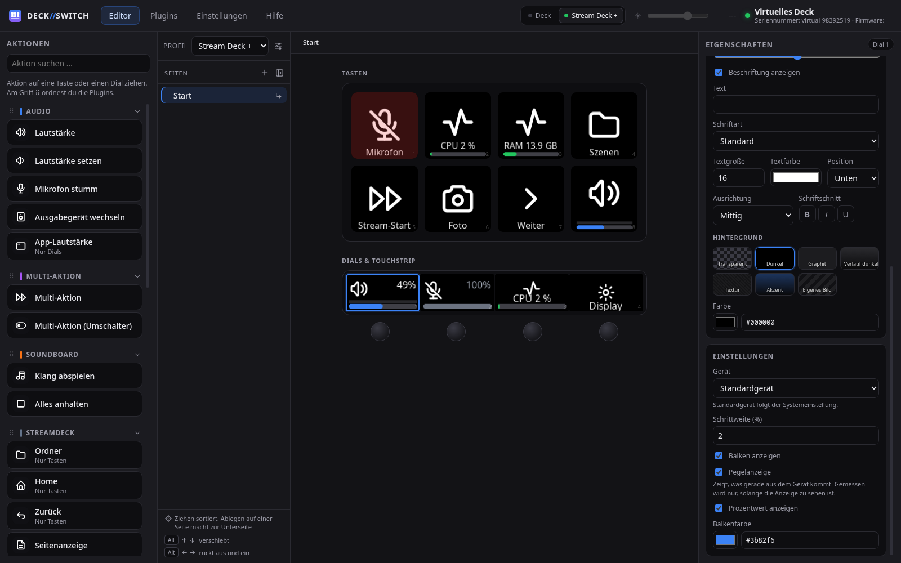
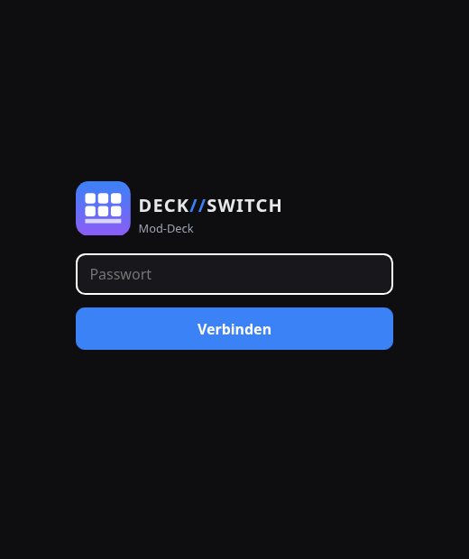
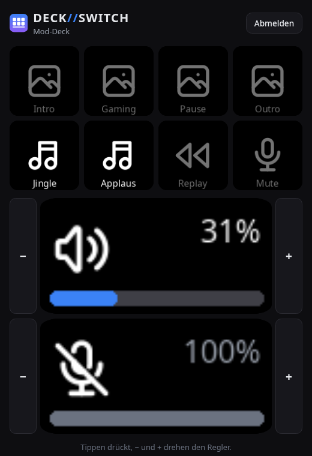
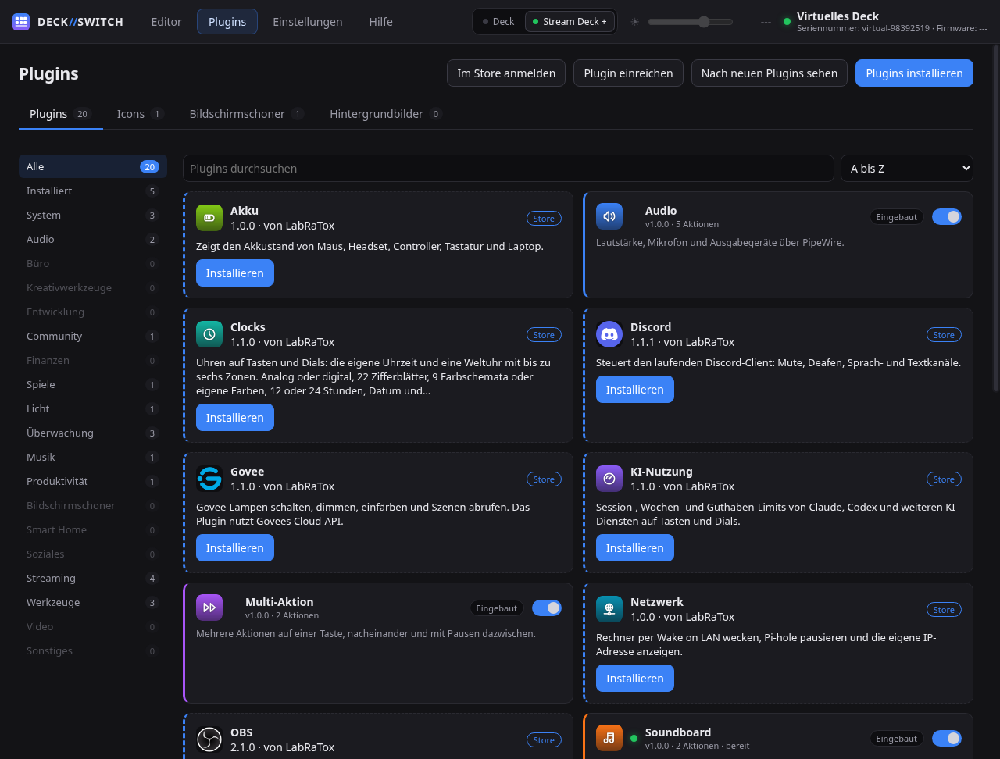
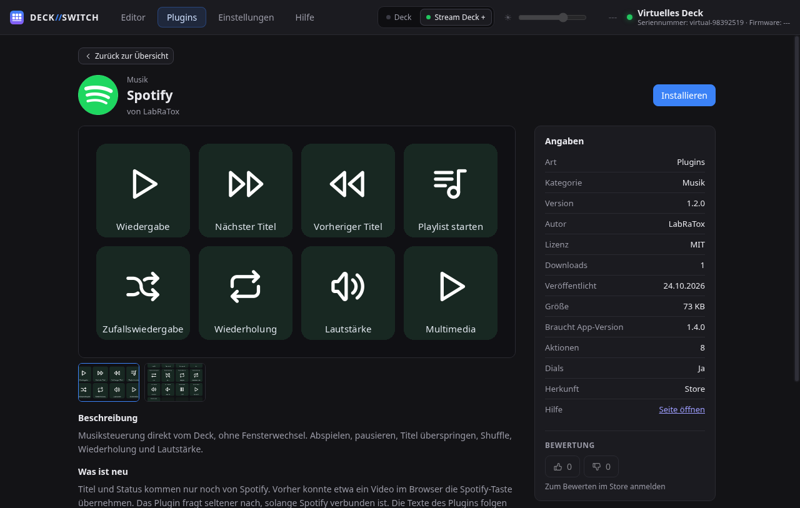

# DECK//SWITCH

*[Deutsche Fassung](README.de.md)*

[](https://discord.gg/2ckNnCZ4wq)



Control software for the **Elgato Stream Deck** on Linux. No official Elgato
software needed, with its own plugin system and a store inside the app.

## Where it runs

**Supported:** CachyOS, Arch Linux, Debian 12 and 13, Ubuntu 22.04, 24.04
and 25.04, Fedora 42 and 43, openSUSE Tumbleweed and Leap 15.6, and Bazzite,
each on x86_64.

- **Linux** with systemd. Developed and tested with a **Stream Deck +** on
  [CachyOS](https://cachyos.org/) with KDE Plasma on Wayland. On the other
  distributions the installation itself is checked in fresh Docker images.
- **Wayland or X11.** On startup the app checks what the session can do and
  only shows actions that work there. What is missing and why is in the
  settings.
- **Desktops:**

| Session | Virtual deck | Window control |
|---|---|---|
| KDE Plasma (Wayland and X11) | yes | yes |
| Hyprland, Sway | yes | yes |
| XFCE, Cinnamon, MATE, i3 … (X11) | yes | no |
| GNOME | yes, through XWayland | no |

The virtual deck never takes the keyboard focus. Window control needs an
interface in the compositor: Plasma, Hyprland and Sway have one, GNOME does
not.

## What it can do

- **Keys and dials**: press, double press and hold per key. Dials adjust
  continuously or fire one action per direction, several can share a dial.
  Swiping the touch strip pages through your layout.
- **Pages and folders** in a tree as deep as you like, sorted by drag and
  drop.
- **Multi-actions** with pauses, steps you switch off one by one, loops and a
  toggle with two chains.
- **Appearance**: icon, label, gradient, texture or image per key, animated
  GIFs included. The preview shows exactly what ends up on the device.
- **Multiple decks** at once, each with its own profile and brightness.
- **Virtual deck**: a deck as an overlay on screen, without a frame or an
  Alt-Tab entry, brought up by a global shortcut.
- **Network deck**: someone else on the same network operates a deck in the
  browser, your moderator during a stream for example. Password protected,
  guests cannot change anything.
- **Screensavers and wallpapers** across all keys and the touch strip.
- **English and German.**

<p align="center">
  
  
</p>

## Plugins

<p align="center">
  
  
</p>

Audio, system, soundboard, multi-action, navigation and the Tabler icon set
are built in. More come from the
[plugin store](https://streamdeckstore.labratox.de), with one click under
**Plugins**. Some of them need a one-time setup, see
[Setting up store plugins](docs/en/store-plugin-setup.md).

- A plugin brings the Python and system packages it needs.
- Updates show up on their own, **Update all** fetches them.
- Store downloads are checked against their SHA-256 before installing.
- Besides the store, a plugin installs from a ZIP file, a URL or a
  `streamdeck://` link in the browser. Your own can be submitted to the store
  from the same window.

How to build one: [Writing plugins](docs/en/plugin-development.md).

## Installation

**Any distribution**, with one command. It fetches `uv` if needed, installs
the newest release and asks for the password once, for system packages, the
udev rule and the `input` group. Running it again updates, the settings stay.

```sh
curl -fsSL https://raw.githubusercontent.com/LabRaTox/Deck-Switch/main/scripts/get.sh | bash
```

**Arch and CachyOS**: download the `.pkg.tar.zst` from the
[latest release](https://github.com/LabRaTox/Deck-Switch/releases/latest),
so updates come through pacman. It needs `python-elgato-streamdeck` from the
AUR first.

```sh
paru -S python-elgato-streamdeck
sudo pacman -U ./deckswitch-*-x86_64.pkg.tar.zst
systemctl --user enable --now deckswitch.service
sudo usermod -aG input "$USER"
```

**From the repository**, for development:

```sh
git clone https://github.com/LabRaTox/Deck-Switch.git
cd Deck-Switch
./scripts/install.sh
```

Afterwards the backend runs at every login and DECK//SWITCH is in the
application menu. Logs: `journalctl --user -u deckswitch -f`.

## More

- [Installation and setup](docs/en/setup.md): the installer in detail,
  removing it, udev, when the window does not open, backup and restore
- [Operation](docs/en/operation.md): editor, key logic, multi-actions, dials,
  appearance
- [Decks](docs/en/decks.md): multiple devices, virtual deck, network deck
- [Plugins](docs/en/plugins.md) and [Writing plugins](docs/en/plugin-development.md)
- [Setting up store plugins](docs/en/store-plugin-setup.md) and
  [Discord setup](docs/en/discord-setup.md)
- [Architecture and development](docs/en/development.md): project layout,
  tests, security, limits

Questions, ideas and your own layouts go to the
[Discord server](https://discord.gg/2ckNnCZ4wq), bugs and feature requests to
[GitHub issues](https://github.com/LabRaTox/Deck-Switch/issues).

All of the device handling builds on
[`python-elgato-streamdeck`](https://github.com/abcminiuser/python-elgato-streamdeck)
by Dean Camera.

MIT, see [LICENSE](LICENSE). Not affiliated with Elgato or Corsair. "Stream
Deck" is a trademark of Corsair Memory, Inc.
